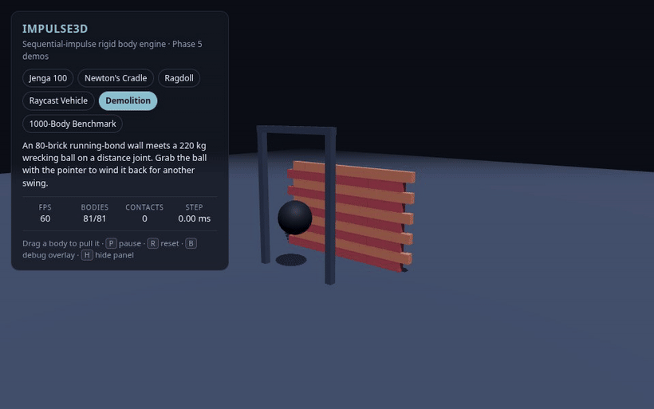
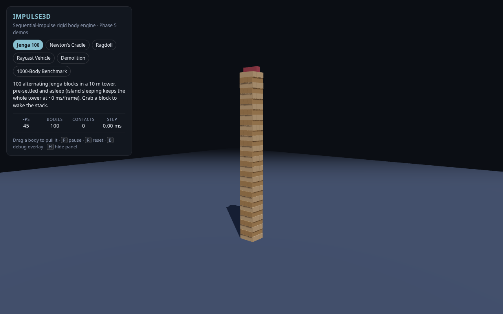
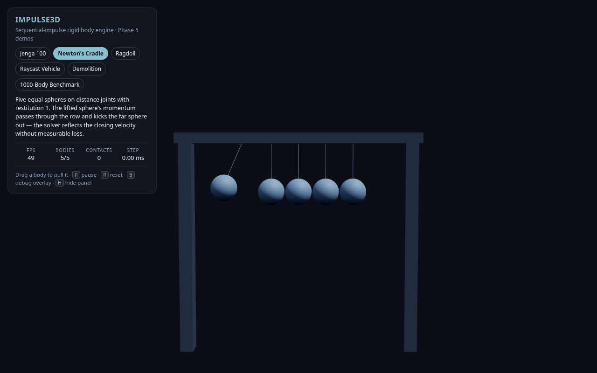
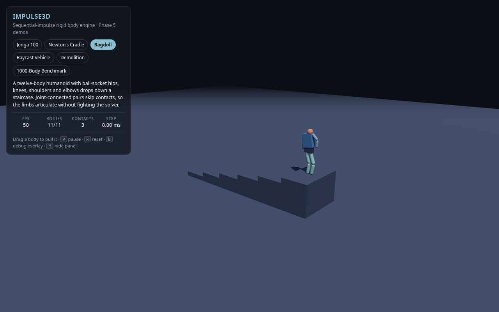
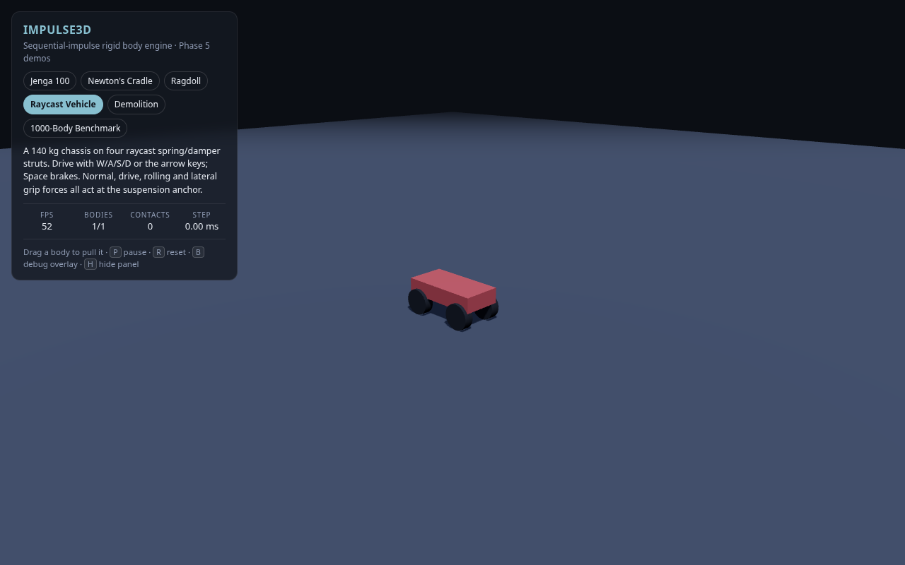
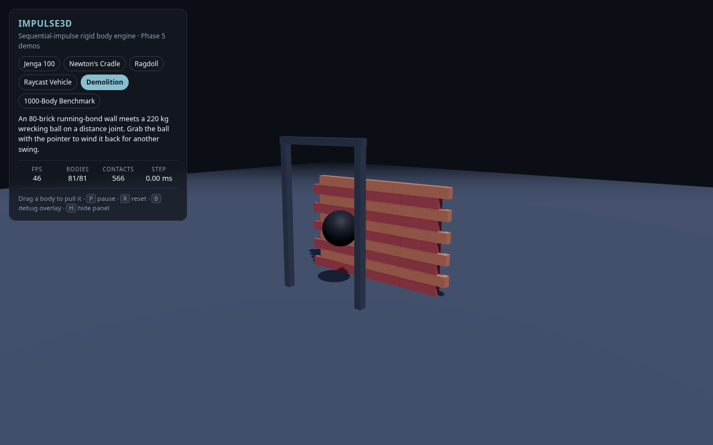
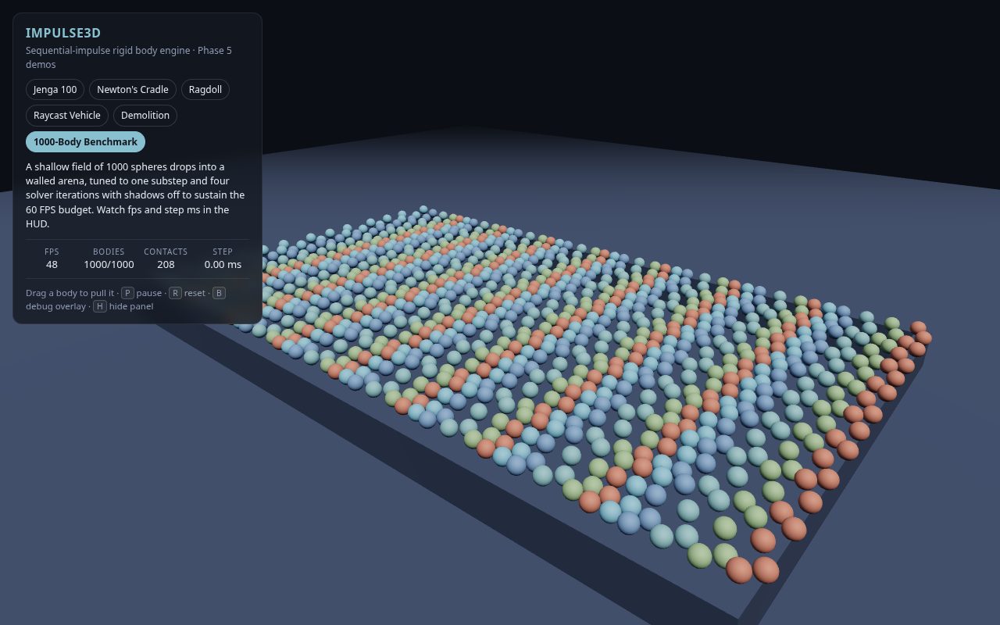
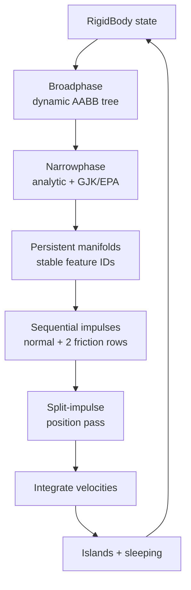

<div align="center">

# Impulse3D

**A zero-dependency 3D rigid-body physics engine in strict TypeScript — with a Three.js playground you can grab with your mouse.**

[](https://github.com/devpryan7792/impulse3d/actions/workflows/ci.yml)
[](LICENSE)
[](tsconfig.json)
[](package.json)
[](vitest.config.ts)

**0** runtime dependencies · **205** tests · **100%** coverage · **1,000** bodies

[Demos](#demos) · [Quick start](#quick-start) · [How it works](#how-it-works) · [Testing](#testing)

</div>



<p align="center"><sub>80 bricks. A 220 kg wrecking ball. One distance joint. No runtime dependencies.</sub></p>

Impulse3D builds the whole simulation stack from scratch: vector and quaternion
math, convex shapes, a dynamic AABB tree, analytic and GJK/EPA collision
detection, persistent manifolds, and a sequential-impulse solver with
split-impulse position correction. The core is plain TypeScript — Three.js is a
dev-only dependency used by the playground.

The goal is a complete, readable implementation of the classic impulse-based
pipeline. It is not a drop-in replacement for Bullet or Jolt, but it is small
enough to read end-to-end and correct enough to stack 100 boxes, hang a ragdoll
from ball sockets, or throw 1,000 spheres at a wall.

## What's inside

| Area | What you get |
| :--- | :--- |
| **Collision** | Analytic sphere/box/capsule/plane paths, clipped box–box manifolds, GJK + EPA for general convex pairs, dynamic AABB tree with velocity-expanded bounds. |
| **Solver** | Sequential impulses over a normal + two tangent rows per point, Coulomb friction, restitution, warm-started normal impulses, split-impulse position correction. |
| **Dynamics** | Static and dynamic bodies, force/torque accumulators, damping, island detection, automatic sleeping, and `BallSocket`, `Hinge` and `Distance` joints. |
| **Playground** | Three.js mesh sync, merged wireframe overlay for AABBs and contact normals, raycast spring grabber, six interactive scenes. |
| **Quality** | Strict TypeScript with no `any`, 205 tests, enforced 100% statement/branch/function/line coverage, headless demo smoke tests, CI on Node 22 and 24. |
| **Shipping** | Zero runtime dependencies. Nothing in `src/` imports Three.js; the demo app lives entirely in `examples/`. |

## Demos

| Jenga 100 | Newton's Cradle |
| :---: | :---: |
| [](examples/src/demos/jenga.ts) | [](examples/src/demos/newtonCradle.ts) |
| 33 layers of three alternating blocks (plus a crown), pre-settled and asleep. Grab a block and the island wakes up. | Five equal spheres suspended by distance joints, with restitution `1.0`. |

| Ragdoll | Raycast Vehicle |
| :---: | :---: |
| [](examples/src/demos/ragdoll.ts) | [](examples/src/demos/vehicle.ts) |
| An 11-body humanoid with ten ball-socket joints tumbling down a staircase. | A 140 kg chassis on four analytic spring/damper struts. Drive with `W`/`A`/`S`/`D`, brake with `Space`. |

| Demolition | 1000-Body Benchmark |
| :---: | :---: |
| [](examples/src/demos/demolition.ts) | [](examples/src/demos/benchmark.ts) |
| An 80-brick running-bond wall versus a 220 kg wrecking ball on a distance joint. | 1,000 dynamic spheres in a walled arena. The HUD reports real step time and frame rate. |

Panels and keys: `P` pause · `R` reset · `B` debug overlay (AABBs + contact
normals) · `H` hide the HUD. Drag any dynamic body to pull it with the spring
grabber. Every scene is deep-linkable: `?demo=jenga`, `?demo=cradle`,
`?demo=ragdoll`, `?demo=vehicle`, `?demo=demolition`, `?demo=benchmark`.

## Quick start

Requires Node.js 22+.

```bash
git clone https://github.com/devpryan7792/impulse3d.git
cd impulse3d
npm install
npm run demo          # http://localhost:5173
```

Build the library and run the full verification suite:

```bash
npm run build             # ESM + type declarations in dist/
npm test                  # 205 tests
npm run test:coverage     # 100% thresholds, enforced
npm run demo:smoke        # headless physics checks for every demo
```

The package is not published to npm. To use it from another project, build it
and depend on the repository (or alias `impulse3d` to `src/index.ts`).

## Usage

```ts
import { BodyType, Box, Plane, RigidBody, Vec3, World } from "impulse3d";

const world = new World();

// Infinite static ground plane (default normal is +Y).
world.addBody(new RigidBody({ shape: new Plane(), type: BodyType.Static }));

// A 1 m cube dropped from 3 m.
const box = world.addBody(
  new RigidBody({
    shape: new Box(new Vec3(0.5, 0.5, 0.5)),
    mass: 1,
    position: new Vec3(0, 3, 0),
    friction: 0.6,
    restitution: 0.1,
  }),
);

for (let tick = 0; tick < 600; tick++) {
  world.step(1 / 60);
}

console.log(`y = ${box.position.y.toFixed(3)}, sleeping = ${box.isSleeping}`);
```

World defaults favor stable stacks: `substeps: 8` and `solverIterations: 10`.
Both are configurable:

```ts
const world = new World({ substeps: 4, solverIterations: 8 });
```

Joints are created from two bodies and a local anchor. Set
`collideConnected = true` if a connected pair should still generate contacts.

```ts
import { BallSocketJoint, Vec3 } from "impulse3d";

const joint = new BallSocketJoint(torso, head, {
  localAnchorA: new Vec3(0, 0.4, 0), // in torso space
  localAnchorB: new Vec3(0, -0.2, 0), // in head space
});
world.addJoint(joint);
```

## How it works



One substep of the pipeline. `World.step(dt)` runs 8 substeps by default and
clears force accumulators once per public step.

A few deliberate choices, all documented in the source:

- **Split-impulse position correction** instead of velocity Baumgarte.
  Penetration is resolved with pseudo-velocities in a separate position pass, so
  correcting overlap does not inject energy into the simulation.
- **Normal impulses are warm-started; friction impulses are not.** Stale
  tangential impulses become wrong when a contact slides or the normal rotates,
  which shows up as creep in tall stacks.
- **Joint-connected pairs skip contacts by default.**
  `collideConnected = false` on every joint; opt in per joint when the connected
  shapes should collide.
- **Contacts are cached by body pair and feature ID.** Warm starting survives
  frames, but a changed feature set resets the accumulated impulses.

The full design and acceptance criteria live in [SPECIFICATION.md](SPECIFICATION.md).

## Performance

Default tuning prioritizes stability: 8 substeps and 10 solver iterations keep a
20-box column standing for 3,000 ticks with no drift. The benchmark scene trades
that for throughput — 1,000 spheres, 1 substep, 4 solver iterations, shadows off
— and reports the real cost in its HUD.

Physics cost is host-dependent. The benchmark measures actual step time and
frame rate in the browser rather than quoting a synthetic number; the checked-in
captures were made under headless software WebGL, so their frame rate is a
floor, not a target.

## Testing

```bash
npm run typecheck           # core, strict, no emit
npm run typecheck:examples  # playground + DOM types
npm test                    # Vitest
npm run test:coverage       # thresholds: 100% statements/branches/functions/lines
npm run demo:smoke          # builds all six demos, steps 480 ticks, checks invariants
```

The suite covers math identities, shape support mappings, GJK/EPA, broadphase
updates, manifold stability, momentum conservation, friction, restitution,
stacking, sleeping, and joint drift. `vitest.config.ts` enforces 100% coverage
over `src/`; the demos are intentionally outside the coverage scope.

CI runs the full matrix on Node 22 and Node 24: typecheck, coverage, library
build, demo build, and the headless smoke test.

## Project layout

```text
src/
├── math/         Vec3, Quat, Mat3, Mat4, Transform
├── collision/    shapes, AABB tree, analytic + GJK/EPA narrowphase, manifolds
├── dynamics/     RigidBody, ContactSolver, joints, islands, World
└── index.ts      public API

tests/            Vitest suites for math, shapes, collision and dynamics
examples/         Vite + Three.js playground (dev-only dependency)
  └── src/demos/  jenga, cradle, ragdoll, vehicle, demolition, benchmark
docs/             README screenshots and capture
```

## Contributing

Issues and pull requests are welcome. Before opening a PR:

```bash
npm run typecheck && npm run test:coverage && npm run demo:smoke
```

Keep the core dependency-free; anything Three.js-related belongs in `examples/`.

## License

MIT — see [LICENSE](LICENSE).

<div align="center">
<sub>Built with strict TypeScript, a stack of Jacobians, and no runtime dependencies.</sub>
</div>
